# Ekran ve akış değerlendirmesi

Amaç: mevcut personel/görev akışını koruyarak dar Android ekranda anlaşılabilirlik,
tema tutarlılığı ve temel erişilebilirlik risklerini incelemek.
Ortam: `nizam-nobet-test`, `emulator-5554`, Android 17 / API 37, 320×640.
Yalnız bu inceleme sırasında sentetik/boş veriyle yakalanan PNG'ler kullanıldı.
Router smoke adımları programatik `go` ile açılır; gerçek menüden E2E navigasyon kanıtı değildir.

## Ana ekran adımları

Her çift açık/koyu temayı gösterir. Dosyalar yerelden açılıp içerikleri incelendi.

| Adım / sağlık | Açık tema | Koyu tema |
|---|---|---|
| 1. Login — render sağlıklı; gerçek giriş yapılmadı | 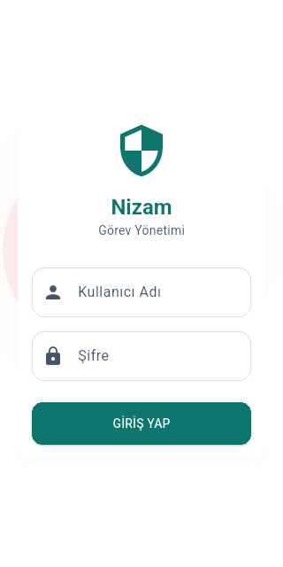 | 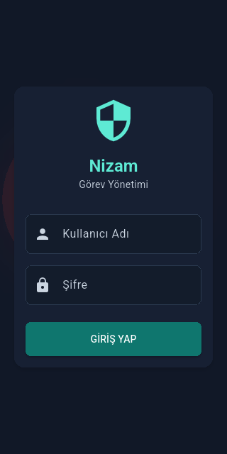 |
| 2. Dashboard — sekiz giriş görünür; bazı alt açıklamalar kısalıyor | 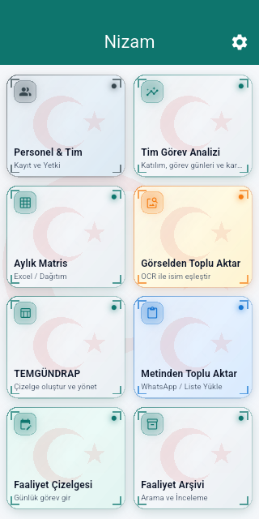 | 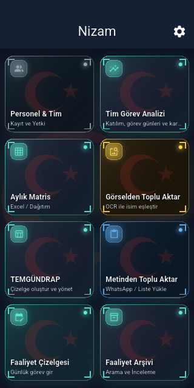 |
| 3. Ayarlar — hesap/tema yüzeyi; Koyu/Sistem etiketleri bölünüyor | 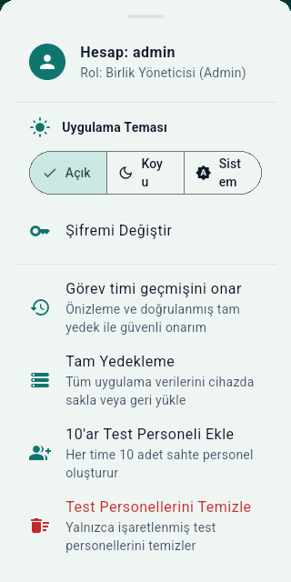 | 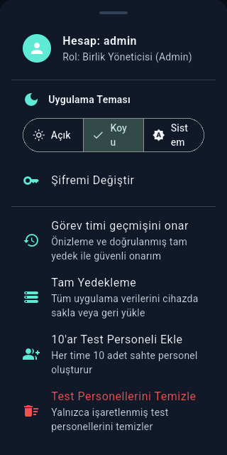 |
| 4. Personel/tim — listeler sağlıklı; başlık kısalıyor | 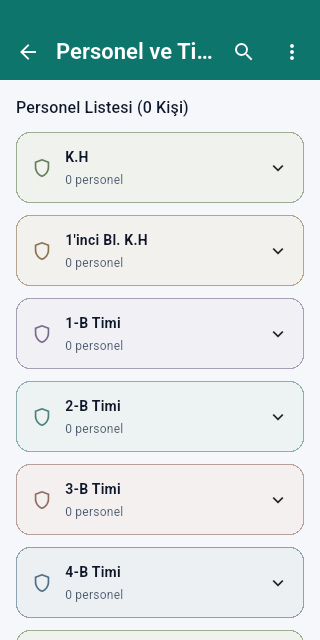 | 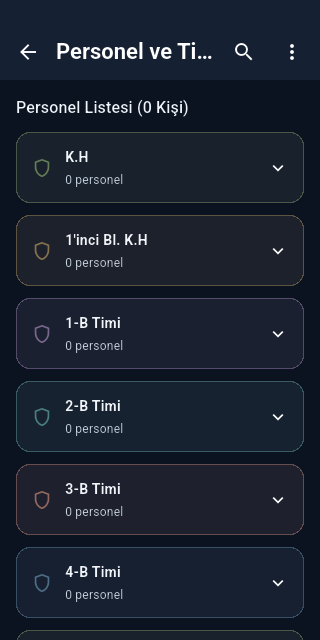 |
| 5. Faaliyet çizelgesi — boş durumda devam pasif | 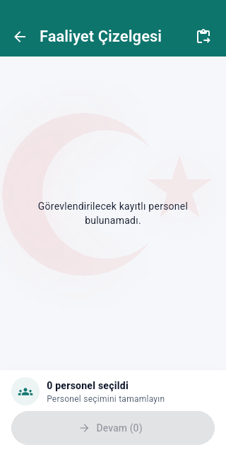 | 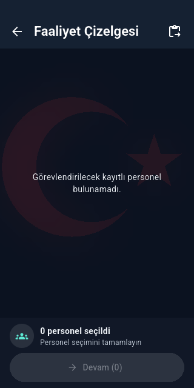 |
| 6. Bekleyen onaylar — boş durum açıklayıcı; başlık kısalıyor | 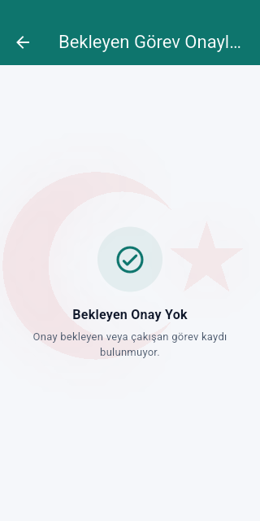 | 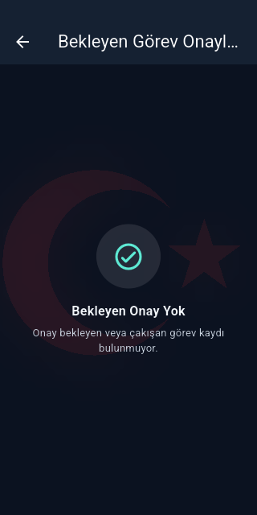 |
| 7. Faaliyet arşivi — tarih/boş durum ve pasif çıktı tutarlı | 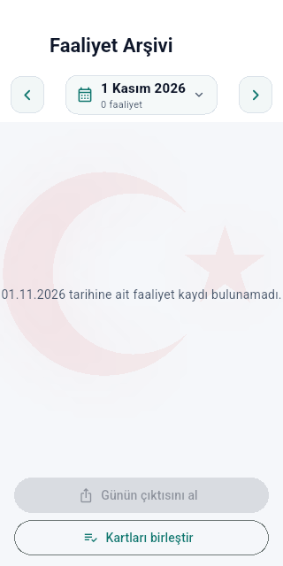 | 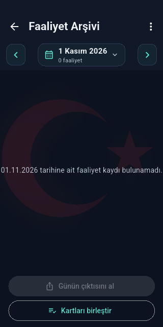 |
| 8. Tim analizi — boş dönem açıklanıyor; üçüncü sekme kısmen dışarıda | 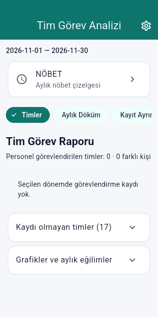 | 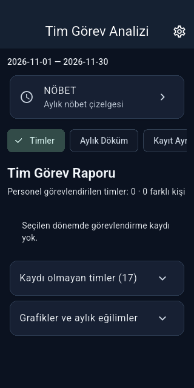 |
| 9. Nöbet takvimi — günler/pazartesi başlangıcı görünür; gerçek kayıt yok | 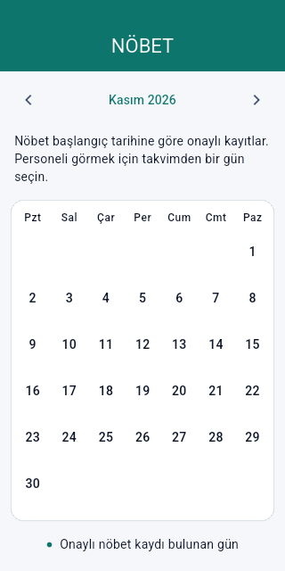 | 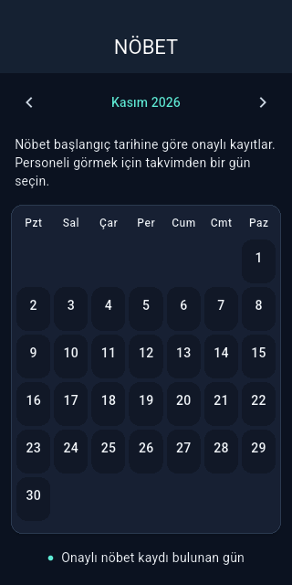 |
| 10. Aylık matris — boş durum sağlıklı; ay başlığı “Ka...” | 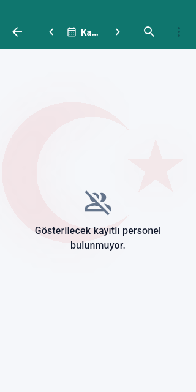 | 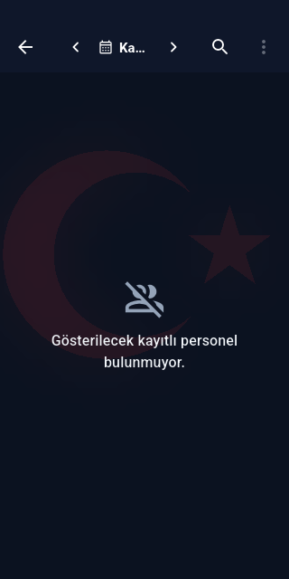 |
| 11. TEMGÜNDRAP — yeni çizelge eylemi belirgin; başlık kısalıyor | 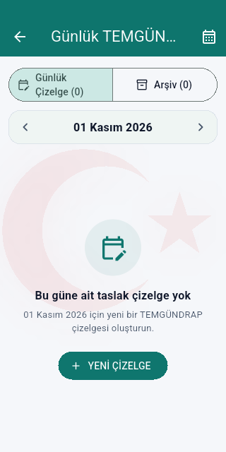 | 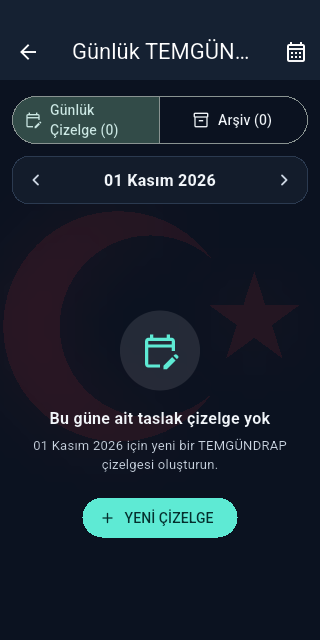 |

## Etkileşimli adımlar

12. **Arşivde sentetik faaliyet — sağlıklı.** Bekleyen kişi durumu gösteriliyor.

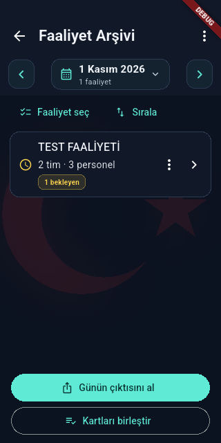

13. **Faaliyet detayı — işlev sağlıklı, dar tim adı kısalıyor.** İki tim/üç kişi sayısı açık.

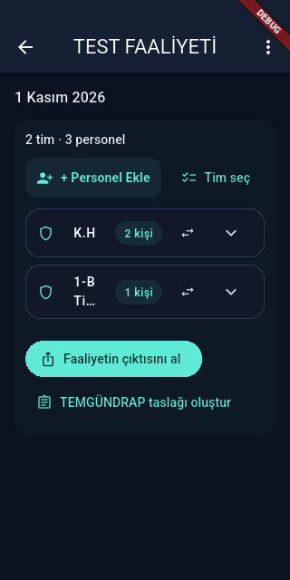

14. **Tim seçimi — sağlıklı.** Seçilen tim vurgusu ve seçim sayısı var.

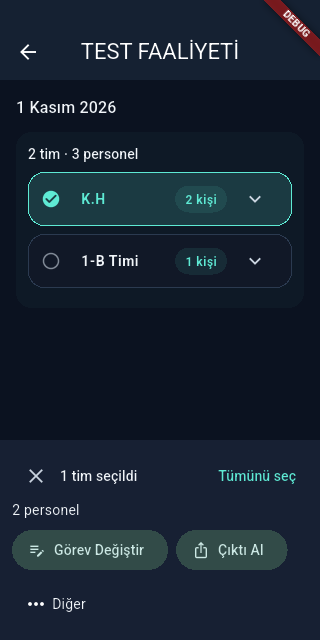

15. **Çıktı seçimi — sağlıklı, Excel uzantısı iki kez görünüyor.** Test yalnız onaylı
kişinin metin çıktısına girdiğini doğruladı. OS paylaşım kanalı mock; dosya/yazıcı teslimi yok.
Alt seçeneklere scroll edilerek ulaşıldı; ekranın altındaki seçeneklerin bu karede görünmemesi hata sayılmadı.

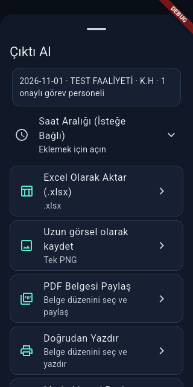

16. **Personel araması — sağlıklı.** MEHMET filtresi yalnız eşleşen kişiyi gösterdi.

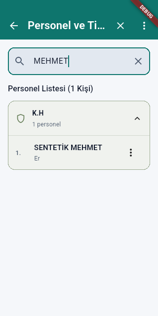
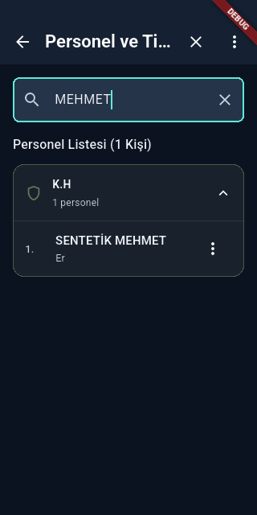

17. **Eşleşmeyen arama — işlev sağlıklı, başlık yanıltıcı.** “Ara...” kesilmiş başlık
değil: `app_tr.arb:23` içindeki gerçek `commonSearch` değeri. `personnel_group_list.dart:53`
bu komut metnini boş-sonuç başlığı olarak kullanıyor. Ayrı “Sonuç bulunamadı” metni daha açık olur.

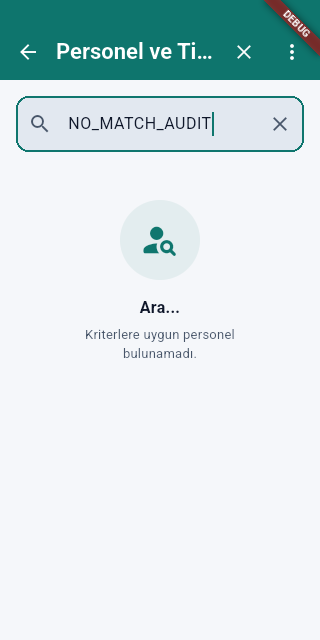
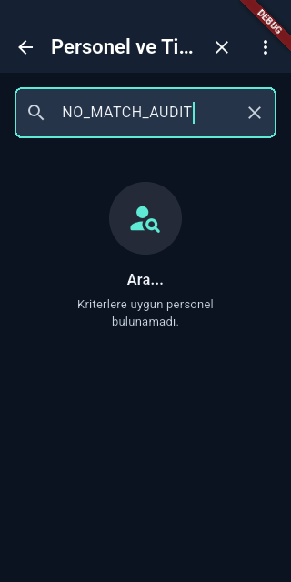

18. **Sıralamayı değiştirip vazgeçme — testte gerçek accessible reorder callback'i
çağrıldı; kaydetmeden çıkış
sonrası personel/tim satırları başlangıçla aynı kaldı.** Görüntü, kaydedilmemiş sıra taslağını gösterir.

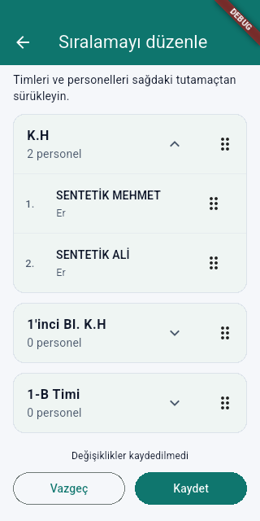
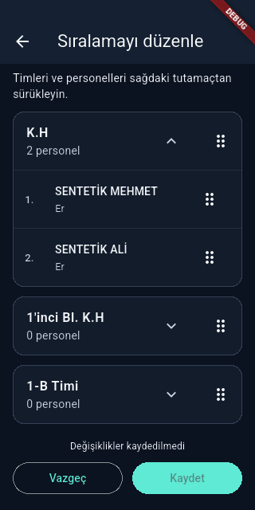

19. **Aylık özet — sağlıklı.** Mevcut kişi/farklı görevli kişi/atama metrikleri ayrılıyor;
kısa ekranda alt kartlar scroll ile açılıyor.

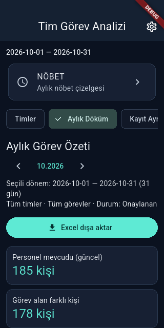

20. **Günlük grafik — sağlıklı.** Gün seçimi ve kayıtlı/planlanan/kayıtsız ayrımı açıklanmış.

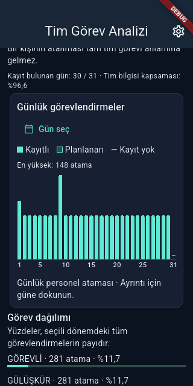

21. **Günün görev detayı — sağlıklı.** Farklı kişi ve atama sayısı ayrı; 148/148.

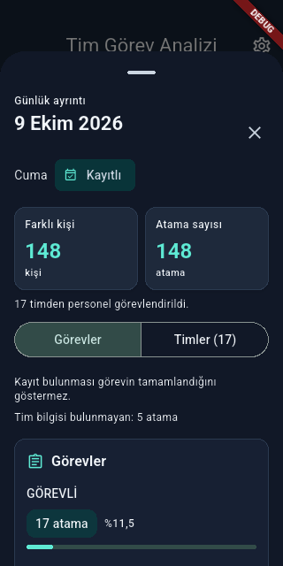

22. **Tim detay sekmesi — sağlıklı.** 17 tim için ayrı liste, üst sayaçlar korunuyor.

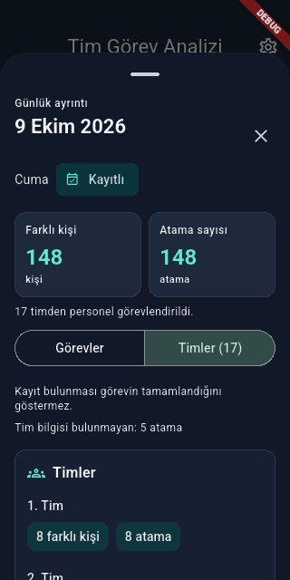

23. **Tim listesini kaydırma — sağlıklı.** Başlık, iki sayaç, sekmeler ve kapat düğmesi
aynı konumda; yalnız liste offset'i değişti. Otomatik geometry assertion'ları geçti.

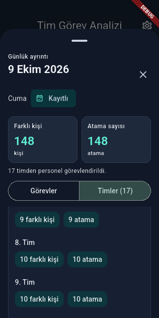

## Bulgular ve öncelik

- **U01 / P2:** Adım 10'da ay kimliği “Ka...” düzeyine düşüyor. Yanlış dönem üzerinde
  çalışma riski; ay/yıl ve kontrolleri ayrı satır veya daha az yatay eylemle yerleştirmek değerlendirilmeli.
  Kaynak: `monthly_matrix_app_bar.dart:43-80`.
- **U02 / P3:** Adım 4/6/11 başlıkları ellipsis; ana eylemler görünür ama ekran kimliği eksiliyor.
  Tam başlık için responsive AppBar düzeni/semantics doğrulaması önerilir.
- **U03 / P3:** Adım 8'de üçüncü sekmenin etiketi kısmen görünür. Yatay kaydırmanın
  keşfedilebilirliğini test et; sırf kesildi diye üçüncü sekme erişilemez sayılmadı.
- **U04 / P3:** Adım 17'de “Ara...” komutunun sonuç başlığı olarak tekrar kullanılması;
  localization var ama bağlamı yanlış. Açıklama satırı doğru sonucu anlatıyor.
- **U05 / P3:** Adım 13'te “1-B Timi” dar alanda “1-B Ti...” oluyor; adım 14'te tam ad var.
  Karar vermeden tam tim adını açabilme/okuyabilme korunmalı.
- **U06 / P3:** Adım 15'te Excel seçeneğinin hem başlığında hem alt satırında `.xlsx`;
  alt açıklamada dosyanın ne içerdiğini söylemek daha yararlı.
- **U07 / P3:** Adım 3'te tema seçenekleri “Koy/u” ve “Sist/em” olarak iki satıra
  bölünüyor. Dar genişlikte seçenekleri ayrı satıra almak veya ikon/metin boşluğunu
  uyarlamak okunabilirliği artırır. Tema değiştirme bu smoke testte yapılmadı.

Login koyu düğmede ilk görsel kontrast şüphesi kaynak/piksel kontrolünde doğrulanmadı:
beyaz metin ve `#0F766E` zemin için hesaplanan oran yaklaşık **5.47:1**.
Bu yalnız o renk çiftidir; tüm uygulamanın erişilebilirlik uygunluğu değildir.

## Kanıt sınırları

- `monthly-matrix-android.png` adlı mevcut test çıktısı tekrar grafik görünümünü
  gösterdiği için **matris kanıtı olarak reddedildi**. Silinmedi; adım 10 gerçek matris
  route'unun boş durum kanıtıdır. Dolu analitik matris görsel doğrulaması NOT_RUN.
- Overlay'li dört arşiv/aylık ve personel fixture karelerindeki DEBUG şeridi test
  MaterialApp'inden gelir. Production root smoke karelerinde yoktur; ürün kusuru sayılmadı.
- TalkBack, odak sırası, klavye, gerçek dokunma hedefleri, tüm renk kontrastları,
  font-scale, landscape, OS dialogları ve fiziksel cihaz kontrolü yapılmadı.
- Route açılışları ve boş durumlar, gerçek import/OCR/backup/restore akışını tamamlamak
  anlamına gelmez. İlgili mevcut host testleri [TESTLER.md](TESTLER.md) içinde ayrıdır.
- Tema/ekran değiştirme ve ayarları açıp kapatma karşılaştırılan dokuz Drift tablosunu değiştirmedi;
  bu, gelecekteki bütün etkileşimler için genel yan etkisizlik garantisi değildir.
  Raw SQL audit/sequence tabloları fingerprint'e dahil değildir.
  Android fiziksel drag ve TalkBack action dispatch doğrulanmadı; order callback'inin
  taslak değişikliği ve Vazgeç'in DB etkisi ayrı kontrol edildi.
