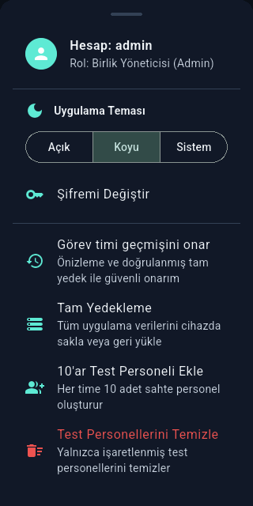
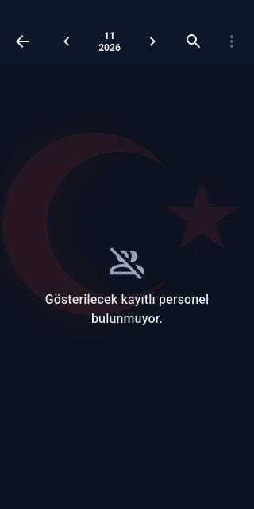
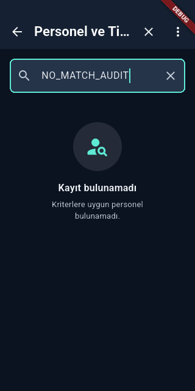
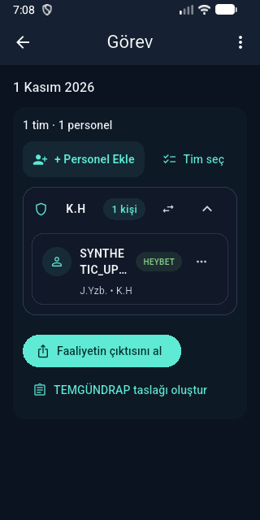
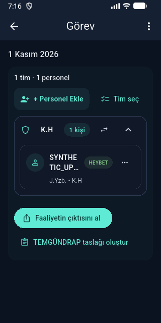

# Audit düzeltmeleri ve APK 1.0.13+10328

Repo: F:/personelapp2. Dal: fix/audit-hardening-apk-2026-11-01.
Base: c16a7e5d4b4cb803d8ec9448d045d08d6a3b9acf.
Kaynak manifesti: [source-manifest.json](source-manifest.json).

## Uygulanan düzeltmeler

- **F01:** Yeni komutan/tim iki yönlü bağlantısı aynı transaction'da yazılıyor.
  Eski tekil null-link hesabı geriye uyumlu çözümleniyor. İki timli belirsiz
  hesap activity watcher'ında veri göremiyor; kayıtlı session açılışta exception
  yerine temizleniyor. Açık yanlış tim bağlantısı kabul edilmiyor.
- **F02:** Actor alan activity mutation'ları işlem transaction'ında güncel DB
  hesabını/rolünü/timini doğruluyor. Silinen/düşürülen admin, admin rolü taklit
  eden commander ve tim yetkisi kaldırılmış commander negatifleri test edildi.
  Mevcut admin-only sınırlaması korunuyor; yalnız UI'daki actor nesnesine güvenilmiyor.
- **F03:** Backup DB tabloları, repair audit ve sqlite sequence tek transaction
  içinde okunuyor. Envelope v2 ve DB schema7 değişmedi. İki gerçek WAL connection
  testi eski kodda tutarsız yedekle FAIL; yeni kodda writer exclusion ve export
  sonrası retry ile PASS. Nested repair transaction da doğrulandı.
- **F04:** Parolası boşaltılmış hesabın kayıtlı username'i session açmıyor.
  Geçerli parolalı session korunuyor; APK güncellemesinde ayrıca kontrol edildi.
- **F05:** Android yedek okuma UI thread dışına alındı. UTF-8 decoder'dan önce
  50 MiB ham-byte sınırı var. Aktif stream iptalde kapanıyor; provider açılışında
  CancellationSignal, geç completion'da weak Activity/identity kontrolü kullanılıyor.
  Doğrudan dosya URI'si yazan backup logları kaldırıldı.

## Davranışı koruyan kalite ve UI değişiklikleri

- 320px'de ay/yıl iki satır sayısal gösterilir; tam Türkçe ay etiketi semantics'te
  korunur. Önceki/sonraki/arama/export eylemleri aynı kalır.
- Dar ekranda tema seçeneklerinin dekoratif ikonları gizlenir; Açık/Koyu/Sistem
  bölünmez. Boş arama başlığı “Ara...” yerine mevcut “Kayıt bulunamadı” çevirisidir.
- Tekrarlanan iki analytics renk değeri aynı ARGB değerleriyle ortak token'a taşındı.
  PDF/Excel baskı renkleri ve iş kodları değişmedi. Watch roster ortak iptal/seç/kapat
  ve ay gezinme etiketleri mevcut l10n'dan gelir.
- README/PROJECT/CHECKS eski shopping/debt/encryption/test sayısı iddiaları düzeltildi.
  Host test runner bütün test klasörlerini çalıştırır; cihaza otomatik kurulum yapmaz.
- output/ kopya QA harness'leri analyzer kapsamından ayrıldı; production ve test
  kaynaklarında kurallar kapatılmadı. Bağımlılık yükseltmesi ve şema migration'ı yok.
- Geçmiş audit'in yapay same-executor interceptor testi gerçek iki bağlantılı
  regression ile değiştirildi; kullanılmayan test helper'ı kaldırıldı.

## Gerçek doğrulama

| Kontrol | Sonuç |
|---|---|
| `flutter test --no-pub --reporter expanded --timeout 2m` | PASS1026 / SKIP1 |
| `flutter analyze --no-pub` | PASS, no issues |
| Yeni Dart dosyaları ve driver formatı | PASS6 dosya /0 değişiklik |
| Native production helper JVM testleri | PASS13 |
| Android activity/history/backup/authority regresyonları | PASS20 |
| Android route/settings smoke, iki tema | PASS4,22 ekran durumu |
| Signed release build | PASS, normal lib/main.dart |
| versionCode/applicationId/signer/16KiB alignment | PASS |
| Signed10327 →10328 upgrade | PASS; [upgrade-verification.json](upgrade-verification.json) |
| Signed APK native file picker sınırı | PASS; exact50MiB, +1 byte ve küçük kontrol; [native-ui-verification.json](native-ui-verification.json) |

Host skip, opt-in dashboard capture testidir. Android reporter'ın tearDownAll sayacı
senaryo sayısına eklenmedi. QA ekranları memory/fixture DB kullanır; backup concurrency
testi task-owned temp dosyada iki bağlantı kullanır. Native13 testi actual Kotlin helper'ı
derler; bağımsız Android Activity/Binder lifecycle instrumentation testi değildir.

Tam ve odaklı loglar [evidence](evidence/) altında; UTC, komut, exit code ve manifest
bağlantısı [verification.json](verification.json) dosyasında tutulur.
Build'de mevcut KGP/SDK metadata/Java8 uyarıları vardır; analiz hatası değildir.

## Artifact kimliği

- Dosya: `F:/personelapp2/build/releases/Nizam-1.0.13+10328.apk`.
- Gerçek package: `com.example.personelapp2`; versionName1.0.13; versionCode10328.
- Boyut:118931171 byte, bütün önceki ABI hedefleri korunur.
- APK SHA-256: `F4219BEA03F0AD4739A8A6D11452353AB16AA898221DF7DAE527CD2970F26F8A`.
- Signer SHA-256: `afa692e51779950a263e6320220a7738d5c3fe5549c8c4b3eeda062a85ede63c`.
- Önceki CI APK gerçekten indirildi: Actions41256938039, artifact13064165568,
  version1.0.12+10327. Yerel10325 ile de aynı signer. Yeni10328 doğrulanan en büyük
  code10327'den büyüktür; fiziksel telefon sürümü bağlı olmadığı için sorgulanmadı.

## Test ortamı teşhisi ve sınırlar

1. İlk release `--no-pub` build'i integration_test'e ait eski generated plugin
   registrant yüzünden derlenmedi. Normal `flutter pub get`/release build ile SDK
   release plugin listesini yeniden üretti. Generated dosya elle yamalanmadı.
2. Driver `.qa` APK'sı gerçek cihaz package bilgisinden doğrulandı. Driver cleanup
   sonrasında test paketleri kaybolduğundan signed baseline **tüm integration
   testleri bittikten sonra** yeniden kuruldu ve gerçek UI'da sentetik kayıtlar
   oluşturuldu. Son upgrade aralığında uninstall, pm clear veya downgrade yoktur.
   Gelecek drive örneği `--keep-app-running` içerir; ayrı AVD zorunluluğu sürer.
3. Upgrade kanıtı sentetik kişi/rütbe/tim, faaliyet/görev, admin session, koyu tema,
   firstInstallTime ve kurulu APK hash'ini kapsar. Byte-for-byte DB karşılaştırması
   veya bütün veri kombinasyonlarının testi olarak sunulmaz.
4. Fiziksel cihaz, bütün OEM sağlayıcıları/Activity lifecycle Binder yarışları,
   gerçek paylaşım/yazıcı ve mağaza yayını NOT_RUN. Gerçek kullanıcı verisi kullanılmadı.
5. Toplu uzun-dosya refactor'u, DB/backup encryption migration'ı, tüm literal
   metinlerin taşınması, CI versionCode otomasyonu ve dependency yükseltmesi bu
   APK'ya alınmadı. Actor almayan mevcut addMedicalReport API'si ayrıca incelenebilir.

Bağımsız F01–F05 kaynak ve imzalı artifact incelemesi blocker bulmadı. Final manifest
SHA-256 `b0ecdc17a64abb232dad5496ce09fe81e01f10a187dd827cc08b1e86b5186d25`;
594 kaynak dosyasında hash uyuşmazlığı yok. Reviewer APK/signer/alignment ve upgrade
XML/metadata kanıtlarını ayrıca doğruladı; testi/ADB etkileşimini yeniden çalıştırmadı.
Son native UI kontrolünde 52428800-byte geçersiz-format JSON okunup Dart format
kontrolüne ulaştı; 52428801-byte dosya okuma hatası verdi. Ardından küçük kontrol
dosyası da okunabildi; hiçbir restore çalışmadı, kayıtlı görev/kişi korundu.
Main merge,
GitHub Release, store/deploy ve Drive upload bu talebin parçası olarak yapılmadı.

## Görsel kanıt

Dar ekranda bölünmeyen tema etiketleri ve okunabilir ay/yıl:

İmzalı eski ve yeni sürümde aynı sentetik görev; dosya hata kontrollerinden sonra da korunuyor:

